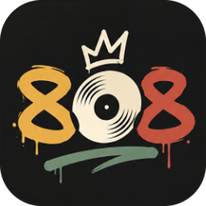

<p align="center">
  
</p>

<h1 align="center">808Soles</h1>

<p align="center">An open-source YouTube Music player for <b>Android</b>, <b>iPhone &amp; iPad</b> and <b>Windows</b>, with an Apple Music–style interface.</p>

<p align="center">
  <a href="https://github.com/MohammedAnasAsif/808Soles/releases/latest/download/808Soles.apk"></a>
  &nbsp;
  <a href="https://github.com/MohammedAnasAsif/808Soles/releases/latest/download/808Soles-Setup.exe"></a>
  &nbsp;
  <a href="#iphone--ipad"></a>
</p>

<p align="center"><a href="https://github.com/MohammedAnasAsif/808Soles/releases/latest"><b>All downloads →</b></a></p>

## Features

- Home feed, New releases, moods & genres, search with suggestions
- Album, artist and playlist pages
- Full-screen Now Playing with blurred-artwork background
- Synced, tap-to-seek lyrics (LRCLIB, with YouTube Music's own lyrics as a fallback)
- Crossfade (0–12 s), Sound Check (loudness levelling), shuffle, repeat, autoplay radio
- Queue: play next, play last, reorder by removing, clear
- Library on the device: loved songs, saved albums & playlists, followed artists, your own playlists, recently played
- Android: native ExoPlayer in a foreground service — plays with the screen off, notification and lock-screen controls, Bluetooth buttons
- iPhone & iPad: native AVPlayer — plays with the screen locked, lock screen and Control Center controls, AirPods and headphone buttons, swipe back; iPad layout in any orientation
- Windows: installer, media keys and the Windows media overlay, keyboard shortcuts (Space, Ctrl+←/→, Ctrl+↑/↓)

No account and no server: the app talks to YouTube Music directly. It is not affiliated with YouTube or Google, and streaming this way is against YouTube's terms of service. Use it at your own risk.

## Download

Use the buttons at the top, or open **[Releases](https://github.com/MohammedAnasAsif/808Soles/releases/latest)**. Every push to `main` rebuilds all three apps and replaces the files there.

- **Android:** open `808Soles.apk` on your phone and allow installing from your browser when asked.
- **Windows:** run `808Soles-Setup.exe`. It isn't code-signed, so SmartScreen may warn: *More info → Run anyway*.
- **iPhone & iPad:** install `808Soles.ipa` from your computer over USB — see below.

Tag a commit `v1.0.0` (`git tag v1.0.0 && git push --tags`) for a versioned release.

### Android updates need a fixed signing key

Android only installs an update over an existing app if both are signed with the same key. Add these two repository secrets (Settings → Secrets and variables → Actions) once:

| Secret | Value |
| --- | --- |
| `ANDROID_KEYSTORE_BASE64` | your keystore file, base64-encoded |
| `ANDROID_KEYSTORE_PASSWORD` | its password (used for the store and the key) |

Create a keystore with (key alias must be `cadence`):

```bash
keytool -genkeypair -v -keystore cadence.jks -alias cadence -keyalg RSA -keysize 2048 -validity 10000
base64 -w0 cadence.jks   # paste the output into ANDROID_KEYSTORE_BASE64
```

Without the secrets the APK still builds, but each build gets a new throwaway key, so you'd have to uninstall before installing a newer one.

## iPhone & iPad

808Soles isn't on the App Store, so you install it yourself ("sideloading"): your computer signs `808Soles.ipa` with your own Apple ID and copies it to your iPhone or iPad over USB. You need iOS 17 or later, a USB cable and an Apple ID (a free one works).

### Install with xtool

[xtool](https://github.com/xtool-org/xtool) runs on Windows (through WSL), Linux and macOS. Installing a ready-made app only needs xtool and your Apple ID — not Xcode.

**1. Get xtool working with your iPhone**

<details>
<summary><b>Windows</b> (WSL)</summary>

1. In PowerShell as administrator, install WSL and USB passthrough, then restart:
   ```powershell
   wsl --install
   winget install usbipd
   ```
2. Open **Ubuntu** from the Start menu and install the tools xtool uses:
   ```bash
   sudo apt-get update
   sudo apt-get install -y usbmuxd libimobiledevice-utils libfuse2t64   # libfuse2 on Ubuntu 22.04
   curl -fL "https://github.com/xtool-org/xtool/releases/latest/download/xtool-$(uname -m).AppImage" -o xtool
   chmod +x xtool && sudo mv xtool /usr/local/bin/
   ```
3. Plug in your iPhone, unlock it and tap **Trust**. In PowerShell as administrator, find **Apple Mobile Device** and attach it to WSL (repeat the attach step whenever you reconnect the phone):
   ```powershell
   usbipd list
   usbipd bind --busid <BUSID>
   usbipd attach --wsl --busid <BUSID>
   ```
4. Back in Ubuntu, `xtool devices` should list your iPhone. If it doesn't, run `sudo usbmuxd` and try again. If you get `AFCClient.Error.muxError`, use [this workaround](https://github.com/xtool-org/xtool/issues/19#issuecomment-2898986718).

</details>

<details>
<summary><b>Linux</b></summary>

```bash
sudo apt-get install -y usbmuxd libimobiledevice-utils
curl -fL "https://github.com/xtool-org/xtool/releases/latest/download/xtool-$(uname -m).AppImage" -o xtool
chmod +x xtool && sudo mv xtool /usr/local/bin/
```

Plug in your iPhone, unlock it, tap **Trust**, and check that `xtool devices` lists it.

</details>

<details>
<summary><b>macOS</b></summary>

```bash
brew install xtool-org/tap/xtool
```

Plug in your iPhone, unlock it, tap **Trust**, and check that `xtool devices` lists it.

</details>

**2. Log in with your Apple ID** (once). Type your password and 2FA code yourself when xtool asks:

```bash
xtool auth login
```

Choose **Password** for a free Apple ID (xtool talks to Apple's developer service with it; a second Apple ID just for this is a cautious choice), or **API Key** if you have a paid Apple Developer membership.

**3. Download and install 808Soles**

```bash
curl -fLO https://github.com/MohammedAnasAsif/808Soles/releases/latest/download/808Soles.ipa
xtool install 808Soles.ipa
```

**4. On the iPhone, the first time only**

- **Settings → General → VPN & Device Management** → your Apple ID → **Trust**.
- **Settings → Privacy & Security → Developer Mode** → on, then restart when asked (iOS requires this for apps you install yourself).

With a free Apple ID, Apple lets a self-installed app run for **7 days**: run `xtool install 808Soles.ipa` again to renew it (your library and downloads stay). Free accounts can have 3 self-installed apps at a time.

**Other installers:** [Sideloadly](https://sideloadly.io) (Windows/macOS, with a window instead of commands) and [AltStore](https://altstore.io) install the same `808Soles.ipa`.

### Build it yourself with xtool

Building from source needs xtool's full setup — the Swift toolchain and Xcode.xip, see [xtool's guide](https://github.com/xtool-org/xtool/blob/main/Documentation/xtool.docc/Installation-Linux.md) — then:

```bash
npm install
npm run ios:sync     # builds the web app and copies it into ios/
cd ios
xtool dev            # builds, signs and installs on the connected iPhone
```

### Good to know

- iOS pauses apps' web content in the background, so while 808Soles isn't on screen it plays on through the next 15 songs of the queue on its own (about an hour). Open the app to let it line up more.
- iPhone plays AAC (M4A) streams, which iOS supports; downloads are saved as `.m4a`.

## Develop

Node 22+.

```bash
npm install
npm run dev            # the app in your browser at http://localhost:5173 (live YouTube through the dev server)
npm run typecheck
npm test
```

- **Windows app locally:** `npm run build && npx electron .`, or `npm run dist:win` for the installer.
- **Android locally:** `npm run android:sync`, then open `android/` in Android Studio (JDK 21).
- **iPhone locally:** `npm run ios:sync`, then `cd ios && xtool dev` (see [Build it yourself with xtool](#build-it-yourself-with-xtool)).

`npm run dev:fixtures` serves captured YouTube responses instead of the live site (set `FIXTURES_DIR`), for working on the interface offline.

## How it works

| Part | Where |
| --- | --- |
| Interface (React, Tailwind) | `src/pages`, `src/components` |
| YouTube Music data, via [YouTube.js](https://github.com/LuanRT/YouTube.js) | `src/yt` |
| Queue and playback logic | `src/store/player.ts` |
| Audio engines: two decks with crossfade | `src/audio` (desktop), `android/.../PlaybackService.java` (Android), `ios/Sources/Soles808/Player.swift` (iOS) |
| Native bridge (HTTP + playback) | `android/.../CadencePlugin.java` (internal name), `ios/Sources/Soles808/Bridge.swift`, `electron/main.cjs` |
| Builds | `.github/workflows/build.yml` |

Streams come from YouTube's VISIONOS client first (direct audio URLs, no PO token), falling back to ANDROID_VR, IOS and TV. Age-restricted tracks need a signed-in account, which 808Soles doesn't support yet.

## Security

See [SECURITY.md](SECURITY.md) for how the apps are protected and how to report a problem.

## License

GPL-3.0-or-later.
